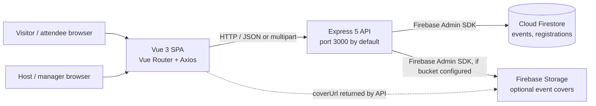
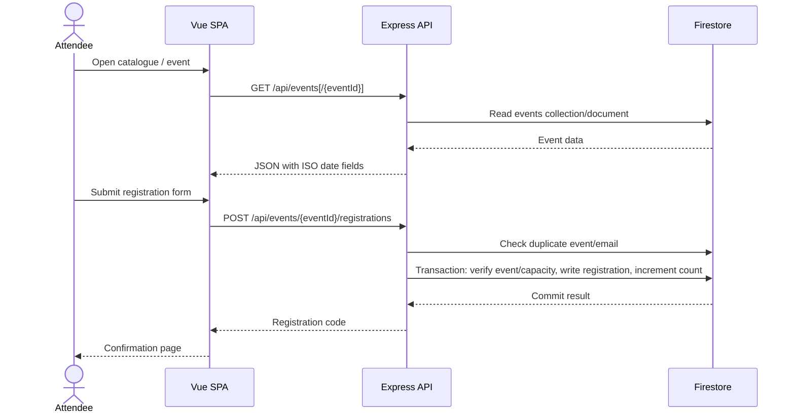

# Event Registration System — System Documentation

## 1. Project overview

### Identity and purpose

The root README identifies the project as **Event Registration System**; the user interface and API use the product name **Evently**. It is a small web application for discovering events, registering attendees, and giving event hosts a browser-based view for publishing and managing events.

The system addresses the basic coordination tasks of advertising an event, tracking available capacity, collecting attendee details, and giving each successful registration a reference code. The README describes this as a student activity project; the source code implements a functional, but deliberately limited, event registration workflow.

### Users and responsibilities

| User type represented by the application | Implemented capabilities |
| --- | --- |
| Visitor / attendee | Browse and filter upcoming events, inspect event details and availability, submit a registration, and view/copy the resulting reference code. |
| Event host / manager | Use `/admin` to publish events, view attendee records and event registration counts, and delete events. |

These are **UI-level roles only**. There is no login, identity provider for users, role model, permission middleware, or authorization check. Any client able to reach the API can access its management endpoints, including event creation/deletion and registration listings. Do not treat `/admin` as a protected administration surface.

### Main implemented features

- Event catalogue, event details, upcoming-event filtering, text search, and category filters.
- Event registration with required name, email, and phone; optional organization; and General, Student, or VIP ticket type.
- Server-side capacity check and increment inside a Firestore transaction.
- Duplicate registration check by event and normalized email.
- Generated registration code in the `EV-XXXXXXXX` form.
- Event creation with optional image cover stored in Firebase Storage.
- Event manager view with event metrics, search, attendee list, refresh, and event deletion.
- Deletion of an event's registration documents when the event is deleted.
- JSON API health endpoint and JSON error responses.
- Sample event seeding script.

### Technology stack

Versions below come from the package manifests; caret/tilde ranges are ranges, not guarantees of the exact installed patch version. Both lockfiles use npm lockfile format version 3.

| Layer | Technologies and versions declared |
| --- | --- |
| Frontend | JavaScript ES modules, Vue `^3.5.40`, Vue Router `^5.2.0`, Vite `^8.1.5`, `@vitejs/plugin-vue` `^6.0.8`, Axios `^1.19.0`, `@lucide/vue` `^1.31.0`. |
| Frontend quality tools | ESLint `^10.7.0`, eslint-plugin-vue `~10.9.2`, Oxlint `^1.78.0`, Prettier `3.9.5`, npm-run-all2 `^9.0.2`. |
| Backend | Node.js ES modules, Express `^5.2.1`, Firebase Admin SDK `^14.2.0`, Multer `^2.2.0`, Nano ID `^6.0.1`, CORS `^2.8.6`, Helmet `^8.3.0`, dotenv `^17.4.2`. |
| Database and file storage | Cloud Firestore and optional Firebase Storage, accessed by the backend through Firebase Admin SDK credentials. |
| Runtime requirement | The frontend manifest declares Node.js `^22.18.0 || >=24.12.0`. The backend manifest does not declare an `engines` range. Use a Node version satisfying the frontend declaration when running both applications. |

There is no Python or machine-learning module, mapping/geolocation integration, end-user Firebase Authentication, email/SMS provider, payment integration, or real-time communication implementation in the inspected project.

### High-level architecture

The frontend is a Vue single-page application served/built by Vite. It calls a separate Express API over HTTP. The API uses Firebase Admin to read and write Firestore documents and, when configured, uploads and deletes event-cover objects in Firebase Storage.



The client does not connect directly to Firestore. Firebase Admin credentials authenticate the **server to Firebase**; they do not authenticate Evently users.

## 2. Repository structure

This documentation was prepared from the root README, both package manifests and lockfiles, backend source, frontend source and configuration, and the visible project tree. Generated dependency directories and ignored environment/credential files were not inspected or included. No Docker, deployment, migration, test, or CI configuration files appear in the visible project tree; the directory name `docker` does not correspond to Docker assets in this project.

```text
docker/                                  Project root
├── .gitignore                           Root ignore rules, including .env and service account key
├── README.md                            Student project title, author/course metadata, short description
├── SYSTEM_DOCUMENTATION.md              This document
├── backend/                              Express API and Firebase integration
│   ├── .env.example                      Present but empty; required variables are listed below
│   ├── package.json                      Backend dependencies and npm scripts
│   ├── package-lock.json                 Locked backend dependency tree
│   └── src/
│       ├── server.js                     API entry point and global middleware
│       ├── config/
│       │   └── firebase.js               Firebase Admin, Firestore, and optional Storage setup
│       ├── middleware/
│       │   └── errorHandler.js           Not-found and error response handlers
│       ├── routes/
│       │   └── events.js                 Event and registration API implementation
│       └── scripts/
│           └── seed.js                   Inserts three sample events
└── frontend/                             Vue SPA and Vite toolchain
    ├── .editorconfig                     Editor formatting defaults
    ├── .gitattributes                    Text-file line-ending normalization
    ├── .gitignore                        Frontend generated/editor ignore rules
    ├── .oxlintrc.json                    Oxlint configuration
    ├── .prettierrc.json                  Prettier formatting options
    ├── .vscode/
    │   └── extensions.json               Suggested VS Code extensions
    ├── README.md                         Vite/Vue starter setup notes
    ├── eslint.config.js                  ESLint flat configuration
    ├── index.html                        SPA HTML shell
    ├── jsconfig.json                     JavaScript `@/*` path alias
    ├── package.json                      Frontend dependencies, scripts, and Node engine
    ├── package-lock.json                 Locked frontend dependency tree
    ├── public/
    │   └── favicon.ico                   Static browser favicon
    ├── vite.config.js                    Vue/Vite plugins and `@` alias
    └── src/
        ├── App.vue                       Shared page shell and navigation
        ├── main.js                       Vue application bootstrap
        ├── assets/
        │   ├── base.css                  Legacy Vue starter styles; not imported by the app
        │   ├── logo.svg                  Vue logo asset; not imported by the app
        │   └── main.css                  Evently global layout and component styling
        ├── components/
        │   ├── EventCard.vue             Reusable event listing card
        │   ├── HelloWorld.vue            Unused Vue starter component
        │   ├── PageLoader.vue             Reusable loading indicator
        │   ├── TheWelcome.vue             Unused Vue starter welcome content
        │   ├── WelcomeItem.vue            Unused Vue starter content row
        │   └── icons/                     Inline SVG icons used by starter content
        │       ├── IconCommunity.vue
        │       ├── IconDocumentation.vue
        │       ├── IconEcosystem.vue
        │       ├── IconSupport.vue
        │       └── IconTooling.vue
        ├── router/
        │   └── index.js                  Client-side routes and lazy-loaded pages
        ├── services/
        │   └── api.js                    Axios API client and error-message helper
        └── views/
            ├── AboutView.vue             Starter placeholder; not registered as a route
            ├── AdminView.vue              Event management and attendee-list UI
            ├── EventDetailsView.vue       Event information and capacity display
            ├── HomeView.vue               Landing page, catalogue, and filters
            ├── RegisterView.vue            Registration form and submission
            └── SuccessView.vue             Confirmation page and registration-code display
```

## 3. File-by-file inventory

### Root

| Path | Category | Responsibility and workflow |
| --- | --- | --- |
| `README.md` | Project metadata | Names the Event Registration System and provides student/course details and a short project description. It is not an installation guide. |
| `.gitignore` | Repository configuration | Ignores `node_modules`, `dist`, `.env`, `serviceAccountKey.json`, logs, coverage, and common editor metadata. Keep credentials out of version control. |
| `SYSTEM_DOCUMENTATION.md` | Documentation | Architecture, setup, APIs, data model, workflows, and limitations documented here. |

### Backend

| Path | Category | Responsibility and relationships |
| --- | --- | --- |
| `backend/package.json` | Package manifest / scripts | Declares ES module mode, Node API dependencies, entry point, `dev`, `start`, `seed`, and `check` scripts. Its `test` script is a placeholder that exits with an error; it does not run tests. |
| `backend/package-lock.json` | Lockfile | Locks the npm dependency tree (lockfile version 3). Use it with `npm ci` for a reproducible backend install. |
| `backend/.env.example` | Configuration template | The file is present but empty. The backend reads its required Firebase values and optional port, CORS origin, and Storage bucket from environment variables. |
| `backend/src/server.js` | Backend entry point | Loads dotenv, creates the Express app, installs Helmet, single-origin CORS, and a 1 MB JSON parser, mounts `/api/health` and `/api/events`, then the 404/error handlers. Defaults to port `3000`. |
| `backend/src/config/firebase.js` | Integration configuration | Requires Firebase project ID, client email, and private key; normalizes escaped newlines in the key; initializes/reuses Firebase Admin; exports Firestore, timestamp and field-value helpers, and an optional Storage bucket. |
| `backend/src/middleware/errorHandler.js` | Express middleware | Returns JSON 404s for unmatched routes and JSON errors for thrown/forwarded errors. It maps upload-size errors to HTTP 400, uses provided error status when available, and logs server errors. |
| `backend/src/routes/events.js` | Routes / domain logic | Defines event listing, details, creation and deletion, plus registration listing and submission. It validates event/registration fields, uploads image covers with Multer, serializes Firestore timestamps, enforces capacity in a transaction, and performs duplicate-email checks. Mounted under `/api/events`. |
| `backend/src/scripts/seed.js` | Seed script | Writes three dated sample events to the `events` collection using a Firestore batch. It creates new auto-ID documents each time; rerunning it adds duplicates rather than replacing existing sample records. |

### Frontend application and tooling

| Path | Category | Responsibility and relationships |
| --- | --- | --- |
| `frontend/package.json` | Package manifest / scripts | Declares Vue, Vue Router, Axios, Lucide icons, Vite, Vue plugin, lint/format tools, the Node engine, and `dev`, `build`, `preview`, `lint`, and `format` scripts. There is no test script. |
| `frontend/package-lock.json` | Lockfile | Locks the frontend dependency tree (lockfile version 3). Use with `npm ci`. |
| `frontend/vite.config.js` | Build/dev-server configuration | Enables Vue SFC compilation and Vue DevTools, and maps `@` to `src`. |
| `frontend/index.html` | SPA document | Provides the `#app` mount point, favicon link, viewport metadata, and loads `src/main.js`; the document title is still the Vite starter title, “Vite App”. |
| `frontend/jsconfig.json` | Editor/module configuration | Defines the `@/*` JavaScript path mapping and excludes generated folders from project analysis. |
| `frontend/eslint.config.js` | Lint configuration | Uses ESLint flat config with recommended JavaScript/Vue rules, browser globals, Oxlint integration, and Prettier-compatible formatting. |
| `frontend/.oxlintrc.json` | Lint configuration | Enables ESLint, Unicorn, Oxc, and Vue plugins and treats correctness diagnostics as errors. |
| `frontend/.prettierrc.json` | Formatting configuration | Sets no semicolons, single quotes, and a 100-character print width. |
| `frontend/.editorconfig` | Editor configuration | Sets UTF-8, two-space indentation, LF endings, final newline, and trailing-whitespace cleanup. |
| `frontend/.gitattributes` | Git configuration | Normalizes text files to LF line endings. |
| `frontend/.gitignore` | Git configuration | Ignores installed dependencies, build output, local environment files, caches, screenshots, and editor artifacts; retains `frontend/.vscode/extensions.json`. |
| `frontend/.vscode/extensions.json` | Developer tooling | Recommends Vue - Official, ESLint, EditorConfig, Oxlint, and Prettier VS Code extensions. |
| `frontend/README.md` | Starter documentation | Provides generic Vue/Vite setup and command examples; it does not describe the Evently API or Firebase configuration. |
| `frontend/src/main.js` | Frontend entry point | Imports `main.css`, creates the Vue app from `App.vue`, installs the router, and mounts to `#app`. |
| `frontend/src/App.vue` | Shared application shell | Renders Evently branding, responsive navigation to discovery and management, route content, and the footer. |
| `frontend/src/router/index.js` | Client routing | Registers `/`, `/events/:id`, `/events/:id/register`, `/registration-success`, and `/admin`; lazily loads non-home views, scrolls to top, and redirects unmatched paths to `/`. No route requires authentication. |
| `frontend/src/services/api.js` | HTTP client | Creates an Axios client with a 15-second timeout and `VITE_API_URL`/localhost base URL. Exposes event/registration calls and maps API errors to a display message. |
| `frontend/src/assets/main.css` | Application styling | Defines Evently color/type tokens, page shell, navigation, responsive layout, forms, event cards, management table, attendee drawer, and success/loading states. It is imported by `main.js`. |
| `frontend/src/assets/base.css` | Legacy stylesheet | Contains Vue starter palette and base styles. It is not imported from the active entry point or `main.css`. |
| `frontend/src/assets/logo.svg` | Static asset | Vue logo from the starter project; not referenced by the active application. |
| `frontend/public/favicon.ico` | Static asset | Browser favicon served by Vite from `/favicon.ico`; binary asset. |

### Frontend components and pages

| Path | Category | Responsibility and relationships |
| --- | --- | --- |
| `frontend/src/components/EventCard.vue` | Reusable UI component | Displays an event cover/fallback theme, category, date/time, description, venue, seats remaining, and a details link. Receives an event prop. |
| `frontend/src/components/PageLoader.vue` | Reusable UI component | Small three-dot loading indicator used by event, registration, and management pages. |
| `frontend/src/views/HomeView.vue` | Page / event discovery | Fetches events on mount, derives upcoming events and aggregate registration count, applies text/category filters, and shows loading, error, empty, and result states through `EventCard`. |
| `frontend/src/views/EventDetailsView.vue` | Page / event details | Loads an event by route ID, formats date and availability, displays event and cover details, and links to registration while seats remain. |
| `frontend/src/views/RegisterView.vue` | Page / attendee registration | Loads the event, collects the required attendee fields and optional organization/ticket type, requires the confirmation checkbox, submits through the API service, and routes to the success page with query-string values. |
| `frontend/src/views/SuccessView.vue` | Page / confirmation | Displays the registration code/name/event from route query parameters and offers a clipboard copy action. Query parameters are presentation data, not independently verified records. |
| `frontend/src/views/AdminView.vue` | Page / event management | Fetches events; calculates total registrations and average fill rate; filters events; submits a multipart event form with optional cover; opens attendee lists; and asks for confirmation before deletion. This page has no authentication gate. |
| `frontend/src/views/AboutView.vue` | Unused starter page | Contains only a generic “about page” placeholder. It is not registered in the router. |
| `frontend/src/components/HelloWorld.vue` | Unused starter component | Generic Vue/Vite greeting accepting a required `msg` prop; not imported by the active application. |
| `frontend/src/components/TheWelcome.vue` | Unused starter component | Generic Vue welcome content with starter documentation/tooling/community links; not imported by the active application. |
| `frontend/src/components/WelcomeItem.vue` | Unused starter component | Generic icon/heading/slot row used by `TheWelcome.vue`; not imported by the active application. |
| `frontend/src/components/icons/IconCommunity.vue` | Starter SVG icon | Inline SVG community/book-style glyph for the unused welcome content. |
| `frontend/src/components/icons/IconDocumentation.vue` | Starter SVG icon | Inline SVG glyph for the unused welcome content. |
| `frontend/src/components/icons/IconEcosystem.vue` | Starter SVG icon | Inline SVG glyph for the unused welcome content. |
| `frontend/src/components/icons/IconSupport.vue` | Starter SVG icon | Inline SVG Material Design icon for the unused welcome content; includes its license/source comment. |
| `frontend/src/components/icons/IconTooling.vue` | Starter SVG icon | Inline SVG tooling glyph for the unused welcome content. |

## 4. Runtime configuration and setup

### Prerequisites

- Node.js `22.18.x` or a version `>=24.12.0`, following the frontend package's declared engine constraint.
- npm compatible with the npm v3 lockfiles.
- A Firebase project with Cloud Firestore enabled.
- Firebase service-account credentials authorized to use the project's Firestore. Configure Firebase Storage and its bucket only if event covers are needed.
- A modern browser with JavaScript enabled.

No Dockerfile, Compose file, database migration runner, or deployment configuration is present.

### Install dependencies

Run each install in its own application directory:

```powershell
Set-Location .\backend
npm ci

Set-Location ..\frontend
npm ci
```

`node_modules` is generated locally and ignored by Git. `npm ci` uses each application's lockfile and requires the corresponding manifest/lockfile pair.

### Backend environment

`backend/.env.example` is currently empty. Create `backend/.env` locally (it is ignored) and provide:

| Variable | Required | Meaning |
| --- | --- | --- |
| `FIREBASE_PROJECT_ID` | Yes | Firebase/GCP project ID used by Firebase Admin. |
| `FIREBASE_CLIENT_EMAIL` | Yes | Service-account client email. |
| `FIREBASE_PRIVATE_KEY` | Yes | Service-account private key. Escaped `\n` sequences are converted to line breaks by `firebase.js`. Never commit the actual key. |
| `FIREBASE_STORAGE_BUCKET` | Only for cover uploads | Storage bucket identifier. If omitted, Storage is not initialized and requests that include an image fail with a server error. |
| `PORT` | No | Express listen port; defaults to `3000`. |
| `CLIENT_URL` | No | Allowed frontend origin for CORS; defaults to `http://localhost:5173`. |

Use secret-management facilities rather than a committed `.env` outside local development. Do not place Firebase Admin credentials in the frontend or in any `VITE_*` variable.

### Frontend environment

There is no frontend environment example file. Optionally create `frontend/.env.local` with:

```dotenv
VITE_API_URL=http://localhost:3000/api
```

`VITE_API_URL` is the Axios base URL, including the `/api` prefix. If unset, the client uses `http://localhost:3000/api`. Vite-exposed variables are shipped to the browser and must not contain secrets.

### Start the applications

Start the backend in one terminal:

```powershell
Set-Location .\backend
npm run dev
```

The development script uses Node's `--watch` mode and starts the API at `http://localhost:3000` by default. `npm start` runs the same entry point without watch mode.

Start the frontend in a second terminal:

```powershell
Set-Location .\frontend
npm run dev
```

Vite normally serves the frontend at `http://localhost:5173`, matching the API's default CORS origin. If either address changes, update `CLIENT_URL` and/or `VITE_API_URL` accordingly.

Check API availability at `GET http://localhost:3000/api/health`. The API initializes Firebase during module loading, so the server needs valid Firebase credentials even for health checks.

### Seed sample events

With backend credentials configured:

```powershell
Set-Location .\backend
npm run seed
```

This inserts three sample events with dates relative to the seed run date. The script creates new Firestore document IDs each run; it is not idempotent and will add duplicate sample events if rerun.

### Production build and preview

```powershell
Set-Location .\frontend
npm run build
npm run preview
```

`build` creates the Vite production bundle in `frontend/dist` (ignored by Git); `preview` serves that built frontend locally. The API is a separate Node process and must be deployed/started separately. No deployment target or server-side hosting configuration is provided in this repository.

## 5. Architecture and workflows

### Event discovery and registration sequence



### Event creation and deletion

1. `AdminView.vue` builds a `FormData` request from its fields and optional image file.
2. Multer stores the image temporarily in memory, limits it to 5 MB, and checks that its MIME type begins with `image/`.
3. The route validates the required event fields and category/capacity. If a cover was supplied, the route uploads it to Firebase Storage and stores its object path and generated tokenized download URL with the event.
4. The API creates a Firestore event document and returns its serialized contents.
5. On deletion, the API reads the event's registrations, deletes those documents and the event in a Firestore batch, then deletes its stored cover object when a cover path exists.

### Error flow

Route handlers forward caught errors to Express middleware. The API emits JSON `{ "message": "..." }` errors. Missing routes return 404; missing records return route-specific 404 messages; invalid fields commonly return 400; duplicate registrations and full events return 409. The frontend's `getErrorMessage` helper displays the response message when present, otherwise a generic connection message.

## 6. Database model

The repository uses **Cloud Firestore**, a document database. There are no SQL migrations, ORM models, schema declarations, explicit index files, or database emulator configuration. The following schema is reconstructed from route and seed reads/writes; optional fields depend on how an event was created.

### Collections

#### `events/{eventId}`

| Field | Type / meaning |
| --- | --- |
| `title` | String; required event name. |
| `description` | String; required event description. |
| `date` | Firestore `Timestamp`; event date. The API serializes it to an ISO-8601 string. |
| `time` | String; displayed event time, stored as entered (not parsed into a time value). |
| `venue` | String; location. |
| `category` | String; one of `Technology`, `Education`, `Business`, `Community`, `Arts`, or `Other`. |
| `organizer` | String; host/organization name. |
| `capacity` | Integer; API accepts 1 through 100,000. |
| `registeredCount` | Integer; starts at 0 for API-created events; incremented transactionally on successful registrations. Seeded examples use preset counts. |
| `createdAt`, `updatedAt` | Firestore server timestamps; serialized as ISO-8601 strings. |
| `coverPath` | Optional string; Firebase Storage object path for uploaded cover. |
| `coverUrl` | Optional string; tokenized Firebase Storage download URL. |
| `theme` | Optional string used by the event card fallback appearance; included in seeded examples. The create route does not accept/persist this field. |

#### `registrations/{registrationId}`

| Field | Type / meaning |
| --- | --- |
| `eventId` | String; ID of the associated event document. |
| `eventTitle` | String; event title copied at registration time. |
| `fullName` | String; required registrant name. |
| `email` | String; required, validated and stored lowercase. Duplicate check uses event ID plus email. |
| `phone` | String; required contact number. |
| `organization` | String; optional school/organization. |
| `ticketType` | String; `General`, `Student`, or `VIP`; unsupported/missing values become `General`. |
| `registrationCode` | String; generated `EV-` prefix plus 8 uppercase Nano ID characters. |
| `createdAt` | Firestore server timestamp; serialized to ISO-8601 for registration-list responses. |

Registrations are linked by the `eventId` field rather than a declared Firestore subcollection/foreign-key constraint. Event deletion manually queries and removes matching registration documents. There is no endpoint for editing events or registrations, canceling a registration, or decrementing `registeredCount`.

## 7. HTTP API

All API routes are mounted at `/api`. JSON error bodies have the shape `{ "message": "..." }`. Endpoints have no user authentication or authorization.

| Method and path | Purpose | Input / output |
| --- | --- | --- |
| `GET /api/health` | Liveness response | Returns `{ "status": "ok", "message": "Evently API is running." }`. Firebase initialization still occurs at startup. |
| `GET /api/events` | List events | Returns an array of events ordered by `date` ascending. |
| `GET /api/events/:eventId` | Read one event | Returns the event JSON; 404 `{ "message": "Event not found." }` if absent. |
| `POST /api/events` | Create event | `multipart/form-data`; required `title`, `description`, `date`, `time`, `venue`, `category`, `organizer`, `capacity`; optional `cover` image. Returns 201 and the created event JSON. |
| `PUT /api/events/:eventId` | Update event | Same multipart fields and validation as create; optional `cover` replaces the existing image. Preserves registrations and returns the updated event JSON; 404 if absent. |
| `DELETE /api/events/:eventId` | Delete event | Deletes the event, its registration records, and its optional cover object. Returns 204 with no body; 404 if event is absent. |
| `GET /api/events/:eventId/registrations` | List attendees | Returns registrations for an existing event, sorted newest first. This endpoint exposes attendee personal data and is not access-controlled. |
| `POST /api/events/:eventId/registrations` | Register attendee | JSON body: required `fullName`, `email`, `phone`; optional `organization`, `ticketType`. Returns 201 with registration ID, code, and success message. |

### Validation and status behavior

- Event create and update require all eight fields above, a parseable date, integer capacity between 1 and 100,000, and an allowed category. Updates cannot reduce capacity below the current registration count. Text fields are trimmed.
- Event cover uploads must have an `image/*` MIME type and be no larger than 5 MB. Storage must be configured if a cover is included.
- Registration requires nonblank name/email/phone and a basic `local@domain.tld`-style email check.
- Registration email is lowercased. A pre-check rejects an existing registration for the same event/email with 409.
- A Firestore transaction re-reads the event, rejects a missing event with 404, rejects a full event with 409, then creates the registration and increments the count.
- `express.json` request bodies are limited to 1 MB. Event create and update endpoints use Multer multipart parsing for cover uploads.
- Unknown route: 404. Upload size error: 400 with the 5 MB message. Unhandled server errors use status 500 unless an explicit error status is set.

### API access and CORS

The API allows the configured CORS origin (`CLIENT_URL`, default `http://localhost:5173`) and `http://localhost:5173` for local Vite development. It uses Helmet with cross-origin resource policy set to `cross-origin` and accepts JSON bodies up to 1 MB. CORS is not authentication and does not prevent direct server-to-server requests. No rate limiter, CSRF layer, auth middleware, or role check is present.

## 8. Authentication, authorization, and privacy

- **End-user authentication:** not implemented.
- **Application roles/permissions:** not implemented. `/admin` is a frontend route only; there is no server-side guard.
- **Firebase authentication:** Firebase Admin uses a service-account credential configured on the backend. This is backend-to-Firebase service authentication only.
- **Sensitive attendee information:** registration list responses include name, email, phone, organization, ticket type, and registration code. The API does not restrict who can retrieve them.
- **Registration confirmation data:** the frontend navigates to the success route with code, event title, and attendee name in URL query parameters.
- **Storage URLs:** uploaded cover URLs include a Firebase Storage download token and are returned to the browser.

The current access model is suitable only for a controlled demonstration unless protected by an appropriate server-side identity/authorization layer and deployment controls. Never expose Firebase Admin private-key values to the browser or commit them.

## 9. Integrations and operational behavior

| Integration | How it is used |
| --- | --- |
| Firebase Admin SDK | Initialized from project ID, service-account email, and private key; provides Firestore access and optional Storage access. |
| Cloud Firestore | Stores events and registrations; event listing sorts by date; registration count and write are coordinated in a transaction. |
| Firebase Storage | Optional event-cover images under `event-covers/`; initialized only when `FIREBASE_STORAGE_BUCKET` is set. |
| Axios | Frontend HTTP transport to the Express API. |
| Lucide Vue icons | UI icons in the Evently pages/components. |

The code does not implement queues, scheduled jobs, events/listeners, email or SMS notifications, payment processing, web sockets, analytics, maps, external AI, or a separate microservice.

## 10. Testing, linting, and validation

No test files or test framework configuration are present in the visible tree.

| Command | Scope / caveat |
| --- | --- |
| `cd backend; npm run check` | Runs `node --check` on `src/server.js` and `src/routes/events.js`. It is a syntax check, not a behavioral test, and does not explicitly check every backend file. |
| `cd backend; npm test` | Not a usable test command currently; the package script prints “Error: no test specified” and exits with status 1. |
| `cd frontend; npm run build` | Builds the Vue application for production; also validates SFC compilation and Vite bundling. Requires installed dependencies. |
| `cd frontend; npm run lint` | Runs Oxlint and ESLint through npm-run-all2. Both configured subcommands include `--fix`, so this command can modify source files. |
| `cd frontend; npm run format` | Runs Prettier with `--write` against `src/`, modifying formatting in place. |

No frontend unit/e2e tests, backend integration tests, Firestore emulator tests, coverage setup, CI workflow, or deployment validation scripts are present.

## 11. Important limitations and extension points

- Add end-user identity and enforce host/admin permissions on the API before using management or attendee-data endpoints in a shared or public deployment.
- The duplicate-email check occurs before the registration transaction; the code does not enforce a unique Firestore constraint on `(eventId, email)`. Concurrent requests with the same email can race.
- The capacity increment is transactionally protected, but there is no registration cancellation/update endpoint.
- The seed script appends records on each run; clear or account for previous seed data before reseeding.
- `backend/.env.example` is empty, and there is no frontend environment template. Keep local configuration private.
- The frontend success route trusts query parameters for its displayed name/event/code; it does not fetch a persisted registration to verify those details.
- `AboutView.vue`, `HelloWorld.vue`, `TheWelcome.vue`, `WelcomeItem.vue`, the icon components, `base.css`, and `logo.svg` are leftover Vue starter assets and are not part of the active Evently workflow.
- `frontend/index.html` still has the generic “Vite App” document title.
- The frontend README describes the Vue/Vite starter, not this system's backend, Firebase setup, or API.
- The repository contains no Docker configuration despite its local folder name.
